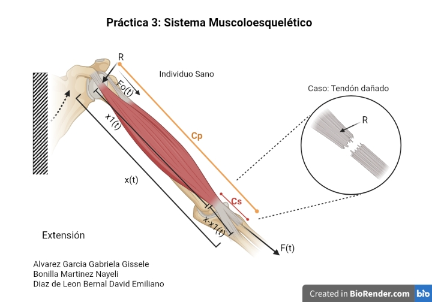

# Práctica 3 — Modelado y control del sistema musculoesquelético

Repositorio académico de **Modelado de Sistemas Fisiológicos**, Ingeniería Biomédica, Tecnológico Nacional de México / Instituto Tecnológico de Tijuana.

**Estudiante:** Nayeli Bonilla Martínez  
**Número de control:** 22212381  
**Correo institucional:** L22212381@tectijuana.edu.mx  
**Docente:** Dr. Paul Antonio Valle Trujillo  
**Correo del docente:** paul.valle@tectijuana.edu.mx  
**Departamento:** Ingeniería Eléctrica y Electrónica  
**Sede:** Blvd. Alberto Limón Padilla s/n, C. P. 22454, Tijuana, B. C., México.  
**Repositorio de la asignatura:** [MSF-IBF1020](https://github.com/DrPaulValle/MSF-IBF1020)

## Contenido

1. [Resumen](#resumen)
2. [Competencia y objetivos](#objetivos)
3. [Modelo mecánico y analogía eléctrica](#modelo)
4. [Diagrama biológico](#diagrama)
5. [Desarrollo matemático y función de transferencia](#matematico)
6. [Error en estado estacionario y estabilidad](#analisis)
7. [Condiciones de simulación](#simulacion)
8. [Implementación en MATLAB, Simulink y Simscape](#matlab)
9. [Control PID](#pid)
10. [Implementación en Python](#python)
11. [Resultados y verificación cruzada](#resultados)
12. [Discusión](#discusion)
13. [Conclusiones](#conclusiones)
14. [Organización y reproducción](#organizacion)
15. [Entregables y referencias](#entregables)

<a id="resumen"></a>
## 1. Resumen

La práctica estudia un modelo mecánico simplificado del sistema musculoesquelético mediante un elemento contráctil activo, un amortiguador viscoso y dos elementos elásticos. Se utiliza la analogía fuerza–voltaje para construir un circuito eléctrico equivalente y obtener las ecuaciones del sistema y su función de transferencia.

Se comparan un individuo sano (**control**) y un caso simulado de atrofia muscular (**caso**). La diferencia entre ambos se representa aumentando la resistencia equivalente de 100 Ω a 10 kΩ. Se analiza su respuesta temporal y estabilidad y se plantea un controlador PID que utiliza la respuesta del individuo sano como referencia. Las implementaciones se realizan en MATLAB/Simulink, Simscape Electrical y Python.

La práctica se desarrolla exclusivamente mediante experimentación *in silico*. El controlador tiene fines académicos y de simulación.

**Palabras clave:** sistema musculoesquelético; analogía fuerza–voltaje; compliancia; amortiguamiento; función de transferencia; PID; simulación.

<a id="objetivos"></a>
## 2. Competencia y objetivos

**Competencia:** modelar sistemas fisiológicos mediante analogías entre sistemas físicos, ecuaciones diferenciales y funciones de transferencia para analizar su comportamiento dinámico y diseñar estrategias de control clásico.

**Objetivo general:** analizar el modelo musculoesquelético y diseñar una estrategia de control que reduzca la diferencia entre la respuesta del caso simulado y la del individuo sano.

**Objetivos específicos:**

- Identificar los elementos mecánicos y sus restricciones de fuerza y desplazamiento.
- Construir la analogía eléctrica y verificar sus ecuaciones.
- Obtener las funciones de transferencia del control y del caso.
- Determinar el error en estado estacionario y localizar los polos.
- Comparar las representaciones por ecuaciones, función de transferencia y circuito equivalente.
- Sintonizar el PID, registrar sus ganancias y evaluar su efecto.
- Reproducir los resultados en Python y documentar las evidencias.

<a id="modelo"></a>
## 3. Modelo mecánico y analogía eléctrica

| Elemento | Descripción |
|---|---|
| F₀(t) | Fuerza del elemento contráctil activo del músculo |
| F(t) | Fuerza transmitida por el sistema |
| R | Amortiguamiento viscoso del tejido |
| Cₚ | Compliancia del elemento elástico paralelo |
| Cₛ | Compliancia del elemento elástico en serie |
| x(t) | Desplazamiento total |
| x₁(t) | Desplazamiento del elemento elástico en serie |
| x(t)-x₁(t) | Deformación del amortiguador |

La fuerza activa cumple F₀(t)=α F(t), con 0<α<1. Las compliancias representan la deformación por unidad de fuerza; sus rigideces correspondientes son 1/Cₚ y 1/Cₛ.

### Correspondencias de la analogía fuerza–voltaje

| Sistema mecánico | Sistema eléctrico |
|---|---|
| Fuerza F(t) | Voltaje V(t) |
| Velocidad ẋ(t) | Corriente I(t) |
| Desplazamiento x(t) | Carga eléctrica q(t) |
| Amortiguador | Resistencia R |
| Compliancia mecánica | Capacitancia C |
| Masa, cuando esté presente | Inductancia L |

En esta analogía, un paralelo mecánico puede convertirse en una serie eléctrica y una serie mecánica puede convertirse en un paralelo eléctrico. Deben verificarse las referencias y las variables de cada rama. El modelo mostrado no incluye masa y no requiere introducir una inductancia.

### Parámetros del circuito equivalente

| Parámetro | Control | Caso |
|---|---:|---:|
| Amplitud de entrada eléctrica | 1 V | 1 V |
| α | 0.25 | 0.25 |
| Cₛ | 10 µF | 10 µF |
| Cₚ | 100 µF | 100 µF |
| R | 100 Ω | 10 kΩ |

Estos valores pertenecen al circuito equivalente. La equivalencia matemática no establece por sí sola una conversión numérica entre voltios y newtons, ni entre carga y desplazamiento físico.

<a id="diagrama"></a>
## 4. Diagrama biológico



**Figura 1.** Representación biológica de los elementos del modelo musculoesquelético: fuerza contráctil, desplazamientos, comportamiento viscoso y elementos elásticos. Imagen proporcionada para la práctica, elaborada en BioRender; se conservan los créditos incluidos en ella.

Para visualizarla en GitHub, colocar `diagrama_biologico.jpeg` en la misma carpeta que `README.md`.

| Elemento del diagrama | Relación con el modelo |
|---|---|
| Elemento contráctil muscular | Generación de F₀(t) |
| Estructuras elásticas musculares | Comportamiento elástico paralelo, Cₚ |
| Tendón | Comportamiento elástico en serie, Cₛ |
| Resistencia al movimiento relativo | Componente viscosa, R |
| Movimiento del conjunto | Desplazamiento total, x(t) |
| Deformación del elemento en serie | x₁(t) |
| Fuerza transmitida | F(t) |

**Nota de interpretación:** la imagen identifica el caso como “tendón dañado”, mientras que el instructivo lo define como un caso simulado de atrofia muscular mediante el incremento de R. Ambas denominaciones no son equivalentes; en este reporte se conserva la definición del instructivo. Los parámetros son equivalentes globales y no mediciones independientes de cada tejido.

<a id="matematico"></a>
## 5. Función de transferencia

El [análisis matemático adjunto](<Análisis Matemático.pdf>) utiliza superposición en el circuito eléctrico equivalente y la transformada de Laplace con condiciones iniciales nulas. Al sumar las contribuciones de las fuentes se obtiene:


**G(s) = Fₛ(s) / F(s) = (Cₛ · R · s + 1 − α) / [R · (Cₚ + Cₛ) · s + 1]**


Aquí F(s) representa la entrada y Fₛ(s) la salida equivalente identificada en el análisis. Esta salida corresponde al voltaje del capacitor paralelo en la analogía eléctrica; se representa como y(t) en las secciones de simulación de este README.

### Individuo sano (control)

Sustituyendo R=100 Ω, Cₛ=10 µF, Cₚ=100 µF y α=0.25:


**G_control(s) = (0.001s + 0.75) / (0.011s + 1)**


### Caso simulado

Con los mismos valores de capacitancia y α, pero R=10 kΩ:


**G_caso(s) = (0.1s + 0.75) / (1.1s + 1)**


Ambas funciones son de primer orden y tienen la misma ganancia estática. La modificación de R cambia la rapidez de la respuesta.

**Variable de salida:** la expresión del PDF es Fₛ(s)/F(s). Si se desea representar el desplazamiento análogo del modelo mecánico, se utiliza Gₓ(s)=CₚG(s). Para comparar las simulaciones deben conservarse la misma variable y escala de salida.

El desarrollo completo por superposición se conserva en el PDF; aquí se presentan únicamente la función general y sus dos sustituciones numéricas. Subir el PDF con el nombre `Análisis Matemático.pdf` a la misma carpeta que el README para activar el enlace.

<a id="analisis"></a>
## 6. Error en estado estacionario y estabilidad

### Valor final ante escalón unitario

Para ambos modelos normalizados:


**y(∞) = Gᵧ(0) = 1 − α = 0.75**


Por ello, la diferencia final entre control y caso en lazo abierto es:


**eₛₛ = y_control(∞) − y_caso(∞) = 0**


Para el desplazamiento análogo, ambos valores finales son Cₚ(1-α)=7.5 × 10⁻⁵ por unidad de entrada. El aumento de R cambia el transitorio, pero no la ganancia estática. El error entrada–salida normalizado sería 1-0.75=0.25; es una definición diferente del error entre control y caso.

### Polos, ceros y constantes de tiempo


**p = −1 / [R · (Cₚ + Cₛ)];    z₀ = −(1 − α) / (R · Cₛ)**


| Característica | Control | Caso |
|---|---:|---:|
| Polo, s⁻¹ | −90.9091 | −0.9091 |
| Cero, s⁻¹ | −750 | −7.5 |
| Constante de tiempo τ, s | 0.011 | 1.1 |
| Ganancia estática normalizada | 0.75 | 0.75 |

Ambos polos son reales negativos: las plantas son estables de primer orden. El caso tiene una constante de tiempo 100 veces mayor, por lo que su componente transitoria decae más lentamente. No se interpreta esta diferencia mediante una razón de amortiguamiento propia de sistemas de segundo orden.

<a id="simulacion"></a>
## 7. Condiciones de simulación

| Condición | Valor o criterio |
|---|---|
| Intervalo temporal | 0 a 10 s |
| Condiciones iniciales | Nulas |
| Entrada solicitada por el instructivo | Impulso unitario |
| Entrada para analizar el estado estacionario | Escalón unitario |
| Comparaciones | Control, caso sin controlador y caso con PID |
| Paso de muestreo propuesto para las gráficas | 10⁻³ s; verificar convergencia numérica |

**Diferencia entre impulso y pulso:** una señal de amplitud 1 activa entre 1 y 2 s es un pulso rectangular de duración 1 s y área unitaria. No es un impulso ideal. Si se utiliza esa señal, debe identificarse como pulso y aplicarse de forma idéntica en MATLAB y Python.

La planta tiene paso directo d=Cₛ/(Cₚ+Cₛ)=1/11. Su respuesta al impulso ideal contiene un término dδ(t) y una parte exponencial. Una gráfica ordinaria representa la parte regular o una aproximación numérica, por lo que no debe compararse su pico directamente con el de un pulso sin explicar la entrada utilizada.

<a id="matlab"></a>
## 8. Implementación en MATLAB, Simulink y Simscape

Se construyen las siguientes representaciones para control y caso:

| Implementación | Contenido | Verificación |
|---|---|---|
| Ecuaciones en Simulink | Equilibrio y relaciones constitutivas o representación de estado equivalente | Salida y escalas consistentes |
| Función de transferencia | Numerador y denominador de cada condición | Coincidencia con el modelo matemático |
| Simscape Electrical | Resistencias, capacitores y fuente dependiente equivalente a F₀=α F | Topología, referencias y variable medida |
| Cuaderno MATLAB | Ejecución de modelos, extracción de señales y gráficas | Comparación y exportación PDF |

### Definición de las plantas normalizadas

```matlab
alpha = 0.25;
Cp = 100e-6;
Cs = 10e-6;
Rcontrol = 100;
Rcaso = 10e3;

Gcontrol = tf([Rcontrol*Cs, 1-alpha], ...
              [Rcontrol*(Cp+Cs), 1]);
Gcaso = tf([Rcaso*Cs, 1-alpha], ...
           [Rcaso*(Cp+Cs), 1]);

Gx_control = Cp*Gcontrol;
Gx_caso = Cp*Gcaso;
pole(Gcontrol)
pole(Gcaso)
```

El cuaderno debe recuperar las respuestas del control, caso en lazo abierto y caso controlado; identificar variables y unidades y guardar las figuras en PDF. Registrar también el solver, tolerancias y paso empleados.

<a id="pid"></a>
## 9. Control PID

La respuesta del individuo sano se utiliza como referencia:


**r(t) = x_control(t);    e(t) = r(t) − x_PID(t)**


La comparación sin tratamiento se expresa como x_control-x_caso. Dentro del lazo cerrado, la señal retroalimentada debe ser la salida del caso con controlador.


**K(s) = kₚ + kᵢ/s + kᴅ · s**

**T(s) = [K(s) · G_caso(s)] / [1 + K(s) · G_caso(s)]**


Como la referencia proviene del modelo sano, la transferencia desde la entrada común hasta la salida controlada es:


**X_PID(s) / F(s) = T(s) · G_control(s)**


Se debe utilizar la misma definición de salida para ambas plantas. Si se trabaja con la salida normalizada, sustituir las variables de desplazamiento por y y utilizar las plantas Gᵧ.

### Sintonización

Usar **Tune** del bloque `PID Controller`, buscando estabilidad y reducción de la diferencia respecto al control. Conservar la captura y los parámetros de la sintonización.

| Parámetro | Valor obtenido |
|---|---|
| kₚ | Pendiente de incorporar |
| kᵢ | Pendiente de incorporar |
| kᴅ | Pendiente de incorporar |
| Filtro derivativo, si se utiliza | Pendiente de incorporar |
| Configuración continua o discreta | Pendiente de incorporar |

Si el bloque utiliza derivada filtrada, reproducir ese filtro en Python. Las ganancias y el filtro deben corresponder a la escala de la planta utilizada. La estabilidad del lazo cerrado debe comprobarse después de la sintonización.

<a id="python"></a>
## 10. Implementación en Python

La implementación permite definir ambas plantas, calcular polos y reproducir las respuestas con las mismas condiciones de simulación.

```python
import numpy as np
import matplotlib.pyplot as plt
import control as ctrl

alpha = 0.25
Cp, Cs = 100e-6, 10e-6

def planta(R):
    return ctrl.tf([R*Cs, 1-alpha], [R*(Cp+Cs), 1])

Gcontrol = planta(100)
Gcaso = planta(10e3)
t = np.linspace(0, 10, 10001)

# Pulso rectangular de 1 V, activo de 1 a 2 s.
u = ((t >= 1) & (t < 2)).astype(float)
_, ycontrol = ctrl.forced_response(Gcontrol, t, u)
_, ycaso = ctrl.forced_response(Gcaso, t, u)

plt.figure(figsize=(10, 5))
plt.plot(t, ycontrol, label='Individuo sano')
plt.plot(t, ycaso, label='Caso sin controlador')
plt.xlabel('Tiempo [s]')
plt.ylabel('Voltaje equivalente normalizado [V]')
plt.title('Respuesta del sistema musculoesquelético a un pulso')
plt.grid(True)
plt.legend()
plt.tight_layout()
plt.savefig('respuesta_pulso_python.pdf', bbox_inches='tight')
plt.show()
```

Este ejemplo utiliza un pulso y salida normalizada. Para estudiar el impulso ideal, considerar el paso directo descrito anteriormente. Incorporar después el controlador sintonizado y simular `T*Gcontrol` ante la entrada común para comparar las tres respuestas.

<a id="resultados"></a>
## 11. Resultados y verificación cruzada

Los valores de polos, constantes de tiempo y ganancias estáticas indicados arriba son resultados analíticos. Las figuras de simulación y las ganancias PID todavía deben incorporarse para documentar resultados computacionales propios.

| Comparación | Evidencia por incorporar |
|---|---|
| Ecuaciones frente a función de transferencia | Gráfica superpuesta para cada condición |
| Modelo matemático frente a Simscape | Gráficas con la misma variable de salida |
| Control frente a caso sin PID | Diferencias en amplitud y rapidez |
| Control frente a caso con PID | Error temporal y efecto del controlador |
| MATLAB frente a Python | Mismas entradas, escalas, ganancias y condiciones iniciales |
| Sintonización | Captura de Tune y parámetros registrados |

Para cuantificar el seguimiento, puede calcularse el error cuadrático medio:


**RMSE = √{(1/N) · Σᵢ₌₁ᴺ [x_control(tᵢ) − x_salida(tᵢ)]²}**


Comparar este indicador antes y después del PID usando la misma malla temporal y la misma escala de salida.

<a id="discusion"></a>
## 12. Discusión

El incremento de R modifica la dinámica sin alterar la ganancia estática cuando Cₚ, Cₛ y α permanecen constantes. El polo se acerca al origen y la constante de tiempo aumenta de 0.011 a 1.1 s. Por ello, aunque las respuestas al escalón alcanzan el mismo valor final, sus transitorios son diferentes.

La coincidencia entre las representaciones debe evaluarse considerando tanto la topología como la variable medida. Comparar x con x/Cₚ sin compensar la escala produciría diferencias numéricas aun si los modelos fueran equivalentes. También deben distinguirse el impulso ideal y el pulso rectangular.

El efecto del PID se determinará al incorporar las simulaciones: se analizará si disminuye el error respecto al individuo sano, si conserva la estabilidad y cómo modifica la amplitud y rapidez de respuesta. Las discrepancias entre herramientas podrán relacionarse con el solver, las tolerancias, el filtro derivativo, la discretización o la definición de la entrada.

El modelo reúne propiedades de varios tejidos en parámetros equivalentes. La modificación de una resistencia no describe por sí sola todos los mecanismos fisiológicos de la atrofia muscular ni del daño tendinoso.

<a id="conclusiones"></a>
## 13. Conclusiones

En esta práctica analicé un modelo simplificado del sistema musculoesquelético mediante la analogía fuerza–voltaje. A partir del análisis por superposición del circuito equivalente identifiqué una función de transferencia de primer orden y distinguí entre la salida eléctrica y el desplazamiento análogo. El análisis mostró que aumentar la resistencia equivalente hace más lenta la respuesta, sin modificar su valor final ante un escalón cuando los demás parámetros permanecen constantes.

Considero que la comparación entre ecuaciones, circuito equivalente y simulaciones permite comprender cómo las propiedades viscosas y elásticas influyen en el comportamiento del sistema. La evaluación final del controlador requiere incorporar las ganancias sintonizadas y las gráficas obtenidas para comprobar cuánto se reduce la diferencia respecto al individuo sano.

<a id="organizacion"></a>
## 14. Organización y reproducción

Los siguientes nombres son sugeridos; ajustar las rutas a los archivos reales del repositorio.

| Archivo o carpeta | Contenido |
|---|---|
| `README.md` | Reporte de la práctica |
| `diagrama_biologico.jpeg` | Imagen mostrada en este README |
| `CITATION.cff` | Datos del alumno y del repositorio |
| `Bonilla22212381.mlx` | Cuaderno de MATLAB |
| `Bonilla22212381.pdf` | Exportación del cuaderno |
| `Bonilla22212381.py` | Implementación Python |
| `modelo_musculoesqueletico.slx` | Modelos de Simulink y Simscape |
| `analisis_matematico.pdf` | Desarrollo matemático complementario |
| `figuras/` | Respuestas exportadas en PDF |
| `evidencias/` | Capturas de modelos y sintonización |
| `LICENSE` | Licencia elegida para el repositorio |

### Requisitos

- MATLAB, Simulink, Simscape y Simscape Electrical.
- Control System Toolbox para las funciones de análisis utilizadas.
- Herramientas de sintonización PID de Simulink.
- Python y, opcionalmente, Visual Studio Code.
- NumPy, Matplotlib y python-control para el ejemplo incluido.

```bash
pip install numpy matplotlib control
```

### Secuencia de reproducción

1. Descargar los archivos y verificar los nombres reales de los modelos.
2. Revisar los parámetros y elegir la variable de salida: desplazamiento análogo o salida normalizada.
3. Ejecutar el análisis matemático, de polos y de estado estacionario.
4. Simular ecuaciones, función de transferencia y circuito equivalente con la misma entrada.
5. Sintonizar el PID y registrar sus ganancias y configuración.
6. Ejecutar el cuaderno MATLAB y exportar las respuestas.
7. Reproducir las simulaciones en Python con los mismos parámetros.
8. Comparar las tres condiciones, completar resultados, discusión y conclusión.
9. Subir el README y `diagrama_biologico.jpeg` a la misma carpeta de GitHub y agregar las demás evidencias.

<a id="entregables"></a>
## 15. Entregables y referencias

### Lista de verificación

- [ ] Análisis del modelo mecánico y de sus restricciones.
- [ ] Analogía electromecánica y circuito equivalente.
- [ ] Desarrollo matemático y funciones de transferencia.
- [ ] Error en estado estacionario, polos y estabilidad.
- [ ] Modelos por ecuaciones y función de transferencia en Simulink.
- [ ] Circuito en Simscape Electrical.
- [ ] Cuaderno MATLAB y exportación PDF.
- [ ] Código Python.
- [ ] Respuestas del control, caso y sistema controlado.
- [ ] Ganancias PID y evidencia de sintonización.
- [ ] Verificación cruzada e interpretación de diferencias.
- [ ] Diagrama biológico y correspondencia con el modelo.
- [ ] Figuras PDF, capturas y archivos complementarios.
- [ ] README final y `CITATION.cff` con los datos correctos.

### Referencias utilizadas

- **Análisis Matemático**, documento manuscrito adjunto, tres páginas: circuito equivalente, superposición y función de transferencia.

1. Material de la asignatura proporcionado para la **Práctica: Modelado y control del sistema musculoesquelético**, sección 5.5, pp. 87–94, Dr. Paul Antonio Valle Trujillo, Tecnológico Nacional de México / Instituto Tecnológico de Tijuana.
2. Diagrama biológico proporcionado para la práctica, elaborado en BioRender. Créditos incluidos en la imagen: Álvarez García Gabriela Gissele, Bonilla Martínez Nayeli y Díaz de León Bernal David Emiliano.

La función de transferencia se tomó del análisis matemático adjunto; los resultados numéricos se calcularon con los parámetros del instructivo. Completar las evidencias computacionales antes de presentar el documento como reporte final.
